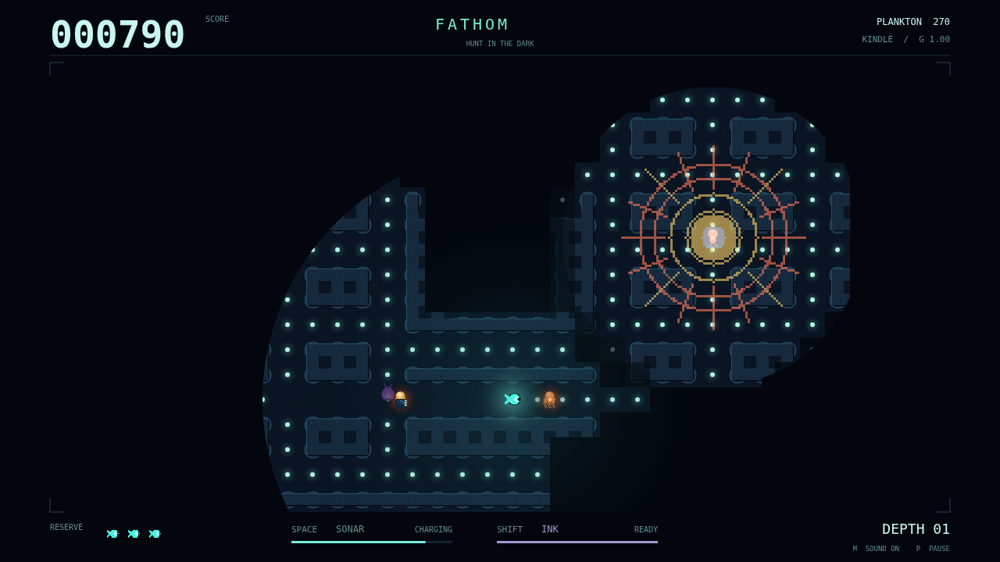

# Fathom

**Hunt in the dark.** A bioluminescent deep-sea maze chase, played entirely in
your browser. Guide a small forager through flooded corridors, eat every plankton
mote, and descend into a deeper, more crowded trench.

This is the **Kindle** dive: explored terrain is remembered, but only the circular
window around you can show it. Eating widens that window and strengthens your
light. It also makes you easier to hunt. Sonar finds routes around corners, ink
blinds light-seekers, and three predators turn your own signals against you.



## Run locally

Use a current Node.js release supported by Vite (Node 22.12+ or 24+).

```sh
npm ci
npm run dev
```

Open the local URL printed by Vite. No backend, credentials, external fonts, or
runtime services are needed.

## Build and deploy

```sh
npm ci
npm run build
```

The complete static site is written to `dist/`, with `index.html` at its root.
Serve that directory unchanged, at either a domain root or a sub-path. Every
asset URL is relative to the page. For a local production check:

```sh
npm run preview
```

## Controls

| Control | Action |
| --- | --- |
| Arrow keys / WASD | Hold to swim; up/down select menu items |
| Space | Sonar pulse; confirm a menu item |
| Shift | Release ink |
| Enter | Confirm a menu item |
| Escape / P | Pause or resume (Escape also goes back in menus) |
| M | Toggle sound |
| Backtick | Toggle the engine's diagnostic overlay |
| Pointer / touch | Select and confirm menus |

Touching the game brings up the engine's directional pad and action buttons.
Release a movement control to stop. Turns are buffered until the next tile
center; reversing direction is immediate.

**Lanternjaw** follows your light and disguises itself as a harmless amber
drifter. **Gloamfin** hears close movement and sonar; sharp corners slow its
chase. **Flarefish** lights the maze with a bloom that can find you through rock.
Clear the maze for a 500-point bonus; each mote is worth 10 and each drifter 200.
You begin with three lives in reserve, in addition to the attempt in play.

## Development and verification

```sh
npm run typecheck
npm run lint
npm run format
npm test
```

Tests drive the real Simple 2D engine over a Node canvas with counted clocks and
injected input. They cover maze geometry, continuous travel and wrap, frame-rate
independence, menu transitions, brightness, fog memory, sonar, ink, predator minds,
the den schedule, scoring, lives, descent, and immutable debug poses. Coverage
and test results are written to `coverage/`.

The engine owns input, timing, canvas fitting, asset loading, audio, diagnostics,
and draw-command recording. `src/game.ts` connects those services to the game;
`src/simulation.ts` is the render-free 120 Hz simulation, `src/world.ts` contains
the grid and movement helpers, and `src/render.ts` draws the dive and its screens.
All persistent game data is held in `FathomState`. The returned `FathomDebugApi`
is available through an engine handle's `debug` member; its poses run through
`engine.apply` and its snapshot reads `engine.state`.

The player-facing presentation and a short engine-recorded replay are in
[`showcase/`](showcase/showcase.md). The full game contract is in `specs/` and
the engine API documentation is in `engine/`.
